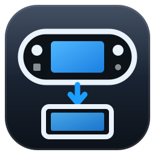
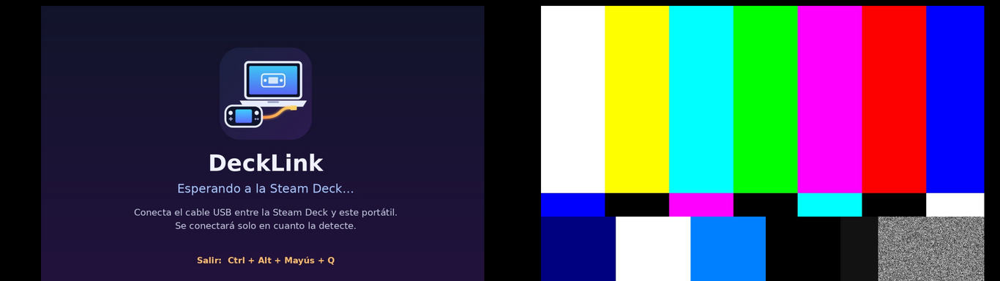

<p align="center">
  
</p>

<h1 align="center">DeckLink</h1>

<p align="center">
  Usa un <b>portátil</b>, un <b>PC con Windows</b>, un <b>móvil Android</b> o unas <b>Meta Quest</b> como pantalla de tu <b>Steam Deck</b>:<br>
  imagen, sonido, teclado, ratón y pantalla táctil. Por cable USB o por wifi. Sin capturadoras.
</p>

---

## ¿Qué hace?

Convierte casi cualquier aparato en una pantalla para la Steam Deck:

| Pantalla | Conexión | Imagen |
|---|---|---|
| Portátil/PC con **Linux** | cable USB o wifi | USB 3: color completo sin pérdidas · USB 2/wifi: JPEG |
| PC con **Windows 10/11** | cable USB o wifi | igual que Linux |
| Móvil o tablet **Android** | wifi (y cable USB si el móvil lo admite) | JPEG; tocar la pantalla = ratón |
| **Meta Quest** (3, 3S, Pro…) | wifi | JPEG en una ventana; apuntar y pulsar = ratón |

- 🖥️ **Imagen** de la Deck a pantalla completa, en **modo juego** y en **modo escritorio** (cambia sola).
- ⌨️ **Teclado y touchpad** del portátil funcionando en la Deck.
- 🔊 **Sonido** de la Deck por los altavoces del portátil.
- 🔌 **Un solo cable USB**:
  - **USB 3:** color completo de 24 bits, sin pérdidas, a 60 fps.
  - **USB 2:** también funciona, con la imagen ligeramente comprimida en JPEG.
- 📶 **Wifi con PIN**: desactivado por defecto; al activarlo, la Deck te da un PIN para que nadie más de tu red pueda conectarse.
- 🖱️ **Sin comandos**: instaladores de doble clic e icono en el escritorio.

## Instalación

Descarga de la [última release](../../releases/latest) el archivo de la Deck y el de tu pantalla:

| Equipo | Archivo | Cómo se instala |
|---|---|---|
| **Steam Deck** (siempre) | `DeckLink-SteamDeck.zip` | descomprime y doble clic en «Instalar DeckLink» |
| Linux (64 bits) | `DeckLink-Portatil.zip` | descomprime y doble clic en «Instalar DeckLink» |
| Windows 10/11 | `DeckLink-Windows-Instalador.exe` | doble clic. Si sale «Windows protegió su PC»: *Más información → Ejecutar de todas formas* (no está firmado) |
| Android | `DeckLink-Android.apk` | ábrelo en el móvil y permite «instalar apps desconocidas» |
| Meta Quest | `DeckLink-Android.apk` | activa el modo desarrollador e instálalo con SideQuest (o desde «Archivos» en las Quest) |

### Wifi (Android, Quest o PC sin cable)

En la Deck: icono **DeckLink → «Activar la conexión por wifi»**. Te mostrará un **PIN**.
Con la Deck y la pantalla en la misma red, abre DeckLink en la pantalla: encuentra la Deck sola y te pide el PIN la primera vez.

### Un paso que solo puedes hacer tú: activar DRD en la BIOS de la Deck

Para que el puerto USB‑C de la Deck pueda funcionar como «dispositivo» (y no solo como «anfitrión»):

1. Apaga la Steam Deck.
2. Mantén pulsados **Volumen +** y **Encendido** hasta oír un pitido.
3. Entra en **Setup Utility → Advanced → USB Configuration**.
4. En **USB Dual-Role Device** elige **DRD** (en vez de XHCI).
5. **Exit → Exit Saving Changes**.

El instalador de la Deck detecta si falta este paso y te lo recuerda.

## Uso

1. Conecta la Deck al portátil con un cable USB **de datos** (USB‑C a USB‑A o USB‑C a USB‑C).
2. En el portátil, doble clic en el icono **DeckLink**.
3. Para salir de la pantalla completa: **Ctrl + Alt + Mayús + Q**.

La Deck queda siempre lista en segundo plano, también en modo juego. La primera vez que conectes en modo escritorio, la Deck pregunta si quieres compartir la pantalla: acepta.
El icono DeckLink de la Deck muestra el estado del cable y permite desactivarlo o desinstalarlo.

<p align="center"></p>

## Cómo funciona

```
 Steam Deck                                              Portátil
┌────────────────────────────┐   cable USB    ┌───────────────────────────┐
│ PipeWire (gamescope / KDE) │ ─────────────▶ │ imagen a pantalla completa│
│ sonido del sistema         │   red USB      │ sonido por los altavoces  │
│ teclado/ratón virtuales    │ ◀───────────── │ teclado y touchpad        │
└────────────────────────────┘ 10.77.0.1 ↔ .2 └───────────────────────────┘
```

- **Red por USB:** la Deck se presenta como una tarjeta de red USB (*USB gadget* de Linux). Usa **NCM** a velocidad USB 3 y **ECM** a velocidad USB 2, porque con NCM a USB 2 los paquetes del portátil hacia la Deck se quedaban retenidos. La tarjeta NCM lleva el identificador de Microsoft **WINNCM**, así que Windows 10/11 carga su driver sin instalar nada; y si a USB 2 el equipo no usa ECM (Windows no tiene driver ECM), la Deck cambia sola a NCM. La Deck reparte la IP por DHCP sin ruta por defecto, así que el internet del equipo sigue por su wifi.
- **Wifi:** la Deck anuncia cada segundo que está disponible (UDP 47801). Las conexiones que no llegan por el cable necesitan que el wifi esté activado en la Deck y el PIN correcto.
- **Calidad automática:** la Deck mide cuánto tarda cada fotograma en llegar y confirmarse. Si la conexión no da para color sin pérdidas, pasa a JPEG, y en JPEG ajusta la calidad para mantener unos 60 fps.
- **Imagen:**
  - **Modo juego:** captura la salida de `gamescope` por PipeWire.
  - **Modo escritorio:** pide la pantalla a KDE con el portal de escritorio; el permiso se recuerda.
  - **USB 3:** se manda en color de 24 bits comprimido con **LZ4**, sin pérdidas.
  - **USB 2:** se manda en **JPEG 4:4:4** con calidad que se ajusta sola.
  - En los dos casos va en franjas que se comprimen y descomprimen en paralelo.
  - La Deck no captura el siguiente fotograma hasta que el portátil confirma el anterior, así el retardo nunca se acumula.
- **Sonido:** PCM de 16 bits estéreo a 48 kHz capturado del monitor de la salida de audio. El portátil nunca acumula más de 80 ms.
- **Entrada:** el portátil manda códigos de tecla y movimientos; la Deck los inyecta con `uinput` como un teclado y un ratón USB más.

## Compilar desde el código

```bash
scripts/todo.sh           # compila y empaqueta todo en dist/
```

Por partes: `scripts/dependencias.sh` y `scripts/dependencias-windows.sh` (SDL2 y libjpeg-turbo estáticas, una vez), `scripts/compilar.sh` + `scripts/empaquetar.sh` (Deck y Linux), `scripts/compilar-windows.sh` (DeckLink.exe e instalador, con MinGW y NSIS) y `scripts/compilar-android.sh` (APK sin Gradle, con las herramientas de Android de Ubuntu).

El programa del portátil va enlazado de forma estática (SDL2, libjpeg-turbo y LZ4 dentro) y carga X11/Wayland y PipeWire/PulseAudio/ALSA al arrancar, así que funciona en casi cualquier distribución con glibc 2.34 o superior.

| Archivo | Qué es |
|---|---|
| `src/decklink-deck.c` | Programa de la Deck: red USB + DHCP (`--red`, como root) y captura/envío (servicio de usuario) |
| `src/decklink-portatil.c` | Pantalla para Linux y Windows: imagen, sonido, entrada y PIN |
| `android/` | App de Android y Meta Quest |
| `paquete/windows/` | Instalador de Windows (NSIS) |
| `src/protocolo.h` | Formato de lo que viaja por el cable |
| `paquete/` | Instaladores, panel de la Deck y desinstaladores |
| `arte/` | Logo y pantalla de espera |

## Limitaciones conocidas

- Android por **cable USB** depende del móvil: tiene que saber usar adaptadores de red USB. Por wifi funciona siempre.
- La APK está firmada con una clave incluida en el repositorio (`android/decklink.keystore`), para que cualquiera pueda compilar versiones compatibles.
- Con DRD activado, si algún dock o hub USB‑C no funciona en la Deck, vuelve a poner XHCI en la BIOS mientras lo uses.
- Para que los símbolos del teclado salgan bien, la Deck tiene que tener configurada la misma distribución de teclado que el portátil.
- El sonido sigue saliendo también por los altavoces de la Deck.

## Licencia

[MIT](LICENSE)
