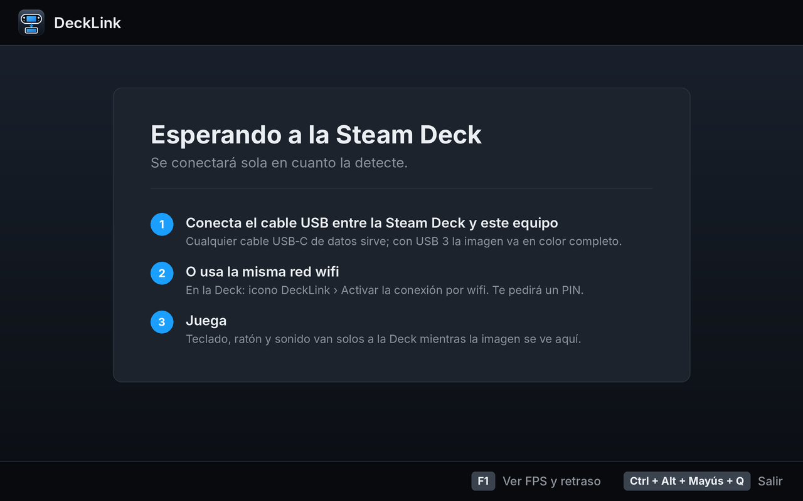
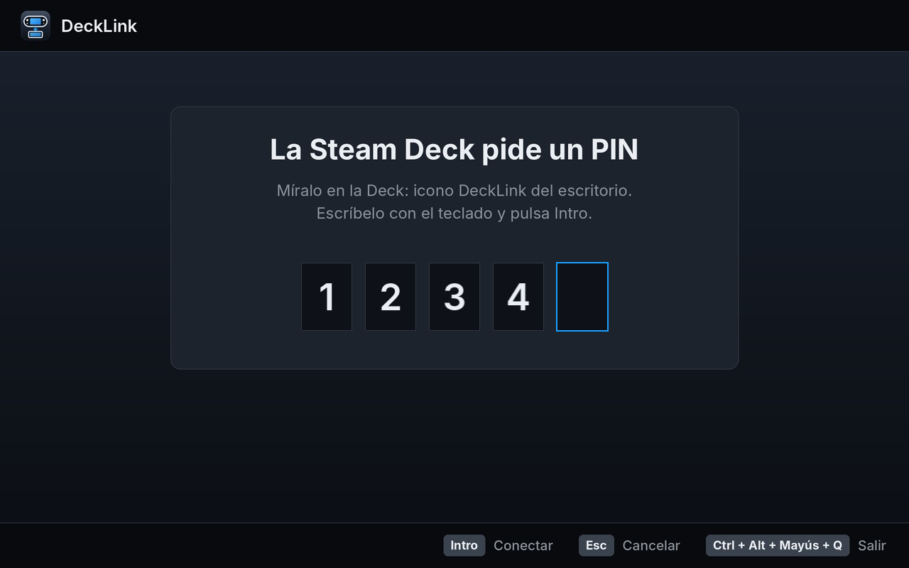
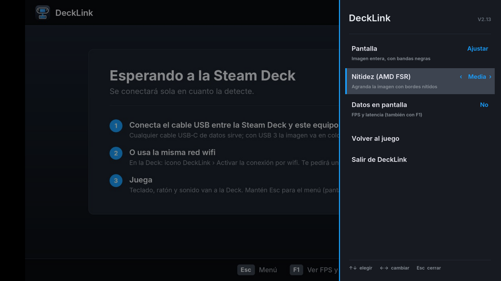
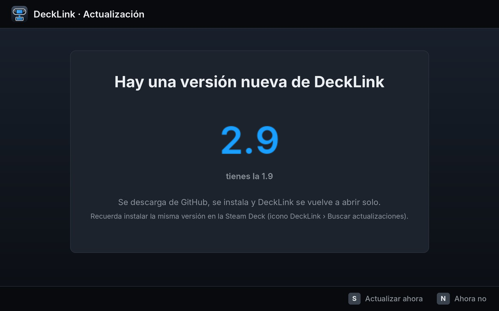

<p align="center">
  
</p>

<h1 align="center">DeckLink</h1>

<p align="center">
  Usa un <b>portátil o PC con Linux</b>, un <b>PC con Windows</b>, un <b>móvil Android</b> o unas <b>Meta Quest</b> como pantalla de tu <b>Steam Deck</b>.<br>
  Imagen a 60 fps, sonido, teclado y ratón. Por cable USB o por wifi. Sin capturadoras.
</p>

<p align="center">
  <a href="../../releases/latest"><b>⬇ Descargar la última versión</b></a>
</p>

<p align="center">
  
</p>

---

## ¿Qué hace?

| Pantalla | Conexión | Imagen |
|---|---|---|
| Portátil/PC con **Linux** | cable USB o wifi | USB 3: color completo sin pérdidas · USB 2 y wifi: JPEG |
| PC con **Windows 10/11** | cable USB (sin drivers) o wifi | igual que Linux |
| Móvil o tablet **Android** | cable USB‑C u OTG, o wifi | JPEG por franjas, pintado con OpenGL |
| **Meta Quest** (3, 3S, Pro…) | wifi | JPEG en una ventana, o en **VR** con pantalla gigante en 2D o **3D** |

- 🎮 **60 fps** en **modo juego** y en **modo escritorio** (cambia sola entre los dos).
- ⚡ **Poco retraso**: unos 15 ms por cable USB 2 en un móvil (se ve con F1 en el PC o con dos toques en el móvil).
- 🖥️ **Menú de imagen**: *Ajustar*, *Estirar* o *Rellenar* (la Deck es 16:10 y casi todas las pantallas 16:9) y **nitidez AMD FSR** para pantallas más grandes que la de la Deck.
- 🥽 **VR en las Quest**: pantalla gigante en 2D o en **3D con IA**: las gafas calculan la profundidad de cada imagen, así que cualquier juego se ve en 3D sin tocar nada en la Deck.
- 🔊 **Sonido** de la Deck en la pantalla.
- ⌨️ **Teclado y ratón** del PC funcionando en la Deck.
- 🔌 **Un solo cable**, y vale cualquier cable USB‑C de datos. Con USB 3 la imagen va sin pérdidas.
- 📶 **Wifi con PIN**: desactivado por defecto. Al activarlo, la Deck te da un PIN para que nadie más de tu red pueda conectarse.
- 🔄 **Se actualiza sola**: el PC y el móvil avisan al abrirse cuando hay versión nueva; la Deck tiene su botón «Buscar actualizaciones».
- 🖱️ **Sin comandos**: instaladores de doble clic e icono en el escritorio.

## Instalación

Descarga de la [última versión](../../releases/latest) el archivo de la Deck y el de tu pantalla:

| Equipo | Archivo | Cómo se instala |
|---|---|---|
| **Steam Deck** (siempre) | `DeckLink-SteamDeck.zip` | en modo escritorio: descomprime y doble clic en «Instalar DeckLink» |
| Linux (64 bits) | `DeckLink-Linux.zip` | descomprime y doble clic en «Instalar DeckLink» |
| Windows 10/11 | `DeckLink-Windows-Instalador.exe` | doble clic. Si sale «Windows protegió su PC»: *Más información → Ejecutar de todas formas* (no está firmado) |
| Android | `DeckLink-Android.apk` | ábrelo en el móvil y permite «instalar apps desconocidas» |
| Meta Quest | `DeckLink-Android.apk` | con el modo desarrollador, instálalo con SideQuest o desde «Archivos» |

### Por cable: activa DRD en la BIOS de la Deck (una sola vez)

Para que el USB‑C de la Deck pueda funcionar como «dispositivo»:

1. Apaga la Steam Deck.
2. Mantén pulsados **Volumen +** y **Encendido** hasta oír un pitido.
3. **Setup Utility → Advanced → USB Configuration → USB Dual-Role Device = DRD**.
4. **Exit → Exit Saving Changes**.

El instalador de la Deck detecta si falta este paso y te lo recuerda.

### Por wifi

En la Deck: icono **DeckLink → «Activar la conexión por wifi»**. Te mostrará un **PIN**.
Con la Deck y la pantalla en la misma red, abre DeckLink: encuentra la Deck sola y te pide el PIN la primera vez.

<p align="center">
  
</p>

## Uso

1. Conecta la Deck con un cable USB de datos (o activa el wifi).
2. Abre **DeckLink** en la pantalla. Se conecta sola.
3. Juega.

| | PC (Linux y Windows) | Android y Quest |
|---|---|---|
| Menú (pantalla, nitidez, datos, salir) | **mantener Esc** (un toque corto va a la Deck) o **F2** | **atrás** |
| Ver FPS y retraso | **F1** | **dos toques** en la pantalla |
| Salir | **Ctrl + Alt + Mayús + Q** o desde el menú | desde el menú |

- La Deck queda siempre lista en segundo plano, en modo juego y en modo escritorio.
- La primera vez que conectes en **modo escritorio**, la Deck pregunta si quieres compartir la pantalla: elige la pantalla y acepta. KDE lo recuerda.
- En Android, la primera vez que conectes por cable, permite que DeckLink use «Steam Deck DeckLink».

### Menú de imagen

<p align="center">
  
</p>

- **Pantalla:** *Ajustar* (imagen entera con bandas negras), *Estirar* (toda la pantalla, un poco deformada) o *Rellenar* (toda la pantalla, recorta un poco arriba y abajo).
- **Nitidez (AMD FSR 1):** agranda la imagen de 1280×800 a tu pantalla con bordes nítidos en vez de borrosos. Suave, Media o Alta. Solo actúa si tu pantalla es más grande que la de la Deck. Se hace en la gráfica y apenas añade retraso.
- Los ajustes se guardan.

### VR y 3D en las Meta Quest

En las Quest, el menú de DeckLink (botón **atrás**) tiene **«Ver en VR (3D)»**: la imagen de la Deck en una pantalla gigante delante de ti. Va por **cable USB‑C** o por **wifi**.

- **3D con IA** (lo normal): llega la imagen de siempre y las gafas calculan la profundidad de cada fotograma con un modelo de IA ([ZipDepth](https://zipdepth.github.io/)), unas 20 veces por segundo, en la gráfica de las gafas. Con eso fabrican una imagen para cada ojo. Funciona con cualquier juego y no hay que instalar nada en la Deck. La idea es la misma que la de [Moonlight XR](https://github.com/Gilleece/moonlight-android-xr).
- **2D**: la pantalla gigante, plana.
- **3D lado a lado**: para juegos que ya sacan su propio 3D *side by side* (o con ReShade SuperDepth3D en la Deck).
- En la VR, **B** (o el botón **≡**) abre el menú: modo de imagen, profundidad (suave, media, fuerte), tamaño de la pantalla y recolocarla delante de ti.
- Por wifi, conéctate una vez con la app normal para escribir el PIN; la VR lo recuerda.

## Actualizaciones

- **PC:** al abrir DeckLink, si hay versión nueva aparece esta pantalla. **S** la instala y DeckLink se vuelve a abrir solo.
- **Móvil:** al abrir la app sale un aviso; «Actualizar» la descarga e instala.
- **Steam Deck:** icono DeckLink → **«Buscar actualizaciones»**.

<p align="center">
  
</p>

## Cómo funciona

```
 Steam Deck                                        Pantalla (PC, móvil, Quest)
┌──────────────────────────────┐   cable USB   ┌──────────────────────────────┐
│ captura: gamescope / KDE     │ ────────────▶ │ imagen a pantalla completa   │
│ sonido del sistema           │  o wifi       │ sonido                        │
│ teclado/ratón virtuales      │ ◀──────────── │ teclado y ratón               │
└──────────────────────────────┘               └──────────────────────────────┘
```

- **Cable USB:** la Deck se presenta como un aparato USB (*USB gadget* de Linux) con dos cosas a la vez:
  - **Un canal propio de DeckLink** (FunctionFS), sin red de por medio. Lo usan el móvil (con el USB del propio Android) y Windows (Windows instala WinUSB solo, gracias a los descriptores de Microsoft).
  - **Una tarjeta de red USB** (NCM a USB 3; ECM y NCM a USB 2). La usa Linux, y la Deck reparte la IP por DHCP sin tocar el internet del equipo.
- **Wifi:** la Deck anuncia cada segundo que está disponible (UDP 47801). Hay que activar el wifi en la Deck y escribir su PIN.
- **Imagen:**
  - **Modo juego:** se captura la salida de `gamescope` por PipeWire.
  - **Modo escritorio:** se pide la pantalla a KDE por el portal de escritorio. La imagen llega en un búfer de la gráfica (DMA-BUF), que la propia gráfica copia a memoria (EGL + PBO): así KDE no se para y se llega a 60 fps.
  - **USB 3 al PC:** color de 24 bits comprimido con **LZ4**, sin pérdidas.
  - **USB 2 y wifi:** **JPEG 4:2:0**, en 8 franjas que se comprimen en paralelo. Al móvil le llega cada franja en cuanto está lista, y empieza a descomprimirla mientras llegan las demás.
  - La calidad se ajusta sola para que cada fotograma cruce el cable en unos 6 ms. Así nunca se forma cola ni se acumula retraso.
- **Sonido:** PCM de 16 bits estéreo a 48 kHz, capturado en su propio hilo para que la imagen nunca lo retrase.
- **Entrada:** la pantalla manda códigos de tecla y movimientos; la Deck los inyecta con `uinput` como un teclado y un ratón USB más.

## Compilar desde el código

```bash
scripts/todo.sh           # compila y empaqueta todo en dist/
```

Por partes:
- `scripts/dependencias.sh` y `scripts/dependencias-windows.sh`: SDL2 y libjpeg-turbo estáticas (una vez).
- `scripts/compilar.sh` + `scripts/empaquetar.sh`: Deck y Linux.
- `scripts/compilar-windows.sh`: `DeckLink.exe` e instalador, con MinGW y NSIS.
- `scripts/compilar-android.sh`: APK sin Gradle, con las herramientas de Android de Ubuntu.
- La parte VR de las Quest se compila con el NDK en GitHub Actions (`.github/workflows/quest.yml`), que deja las bibliotecas en la rama `nativo`; `compilar-android.sh` las añade al APK si están en `build/quest/`.
- `scripts/generar-recursos.py`: pantallas, icono y fuente del programa de PC a partir de `arte/`.

El programa de PC va enlazado de forma estática (SDL2, libjpeg-turbo y LZ4 dentro) y carga X11/Wayland y PipeWire/PulseAudio/ALSA al arrancar, así que funciona en casi cualquier distribución con glibc 2.34 o superior.

| Archivo | Qué es |
|---|---|
| `src/decklink-deck.c` | Programa de la Deck: aparato USB y DHCP (`--red`, como root) y captura/envío (servicio de usuario) |
| `src/lectura_gpu.c` | Lectura de la pantalla del escritorio con la gráfica (EGL + GLES) |
| `src/decklink-portatil.c` | Pantalla para Linux y Windows: imagen, sonido, entrada, PIN, menú y actualizaciones |
| `src/lienzo.c` | Dibujo del PC con OpenGL: modos de pantalla y AMD FSR 1 (EASU + RCAS) |
| `src/quest/decklink-vr.c` | Modo VR de las Quest (OpenXR nativo): pantalla gigante en 2D o 3D |
| `android/` | App de Android y Meta Quest |
| `src/protocolo.h` | Formato de lo que viaja por el cable y versión |
| `paquete/` | Instaladores, panel de la Deck, desinstaladores e instalador de Windows (NSIS) |
| `arte/` | Icono y pantallas |

## Limitaciones conocidas

- Con DRD activado, si algún dock o hub USB‑C no funciona en la Deck, vuelve a poner XHCI en la BIOS mientras lo uses.
- La mayoría de móviles tienen el USB‑C a velocidad USB 2: funciona igual de bien, con la imagen en JPEG.
- En modo escritorio el límite lo pone KDE: unos 59‑60 fps.
- Para que los símbolos del teclado salgan bien, la Deck tiene que tener configurada la misma distribución de teclado que el PC.
- El sonido sigue saliendo también por los altavoces de la Deck.
- La APK está firmada con una clave incluida en el repositorio (`android/decklink.keystore`), para que cualquiera pueda compilar versiones compatibles.

## Licencia

[MIT](LICENSE). AMD FidelityFX FSR 1 es de AMD, también con licencia MIT. El modelo de profundidad ZipDepth es de Fabio Tosi, Luca Bartolomei, Matteo Poggi y Stefano Mattoccia (Universidad de Bolonia), con licencia MIT; su versión para LiteRT viene del proyecto Moonlight XR. LiteRT (TensorFlow Lite) es de Google, con licencia Apache 2.0.
